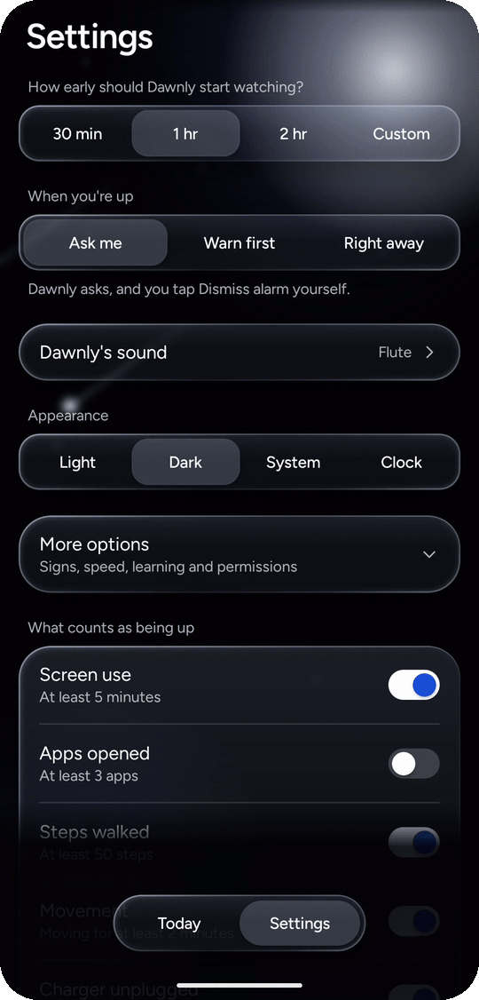
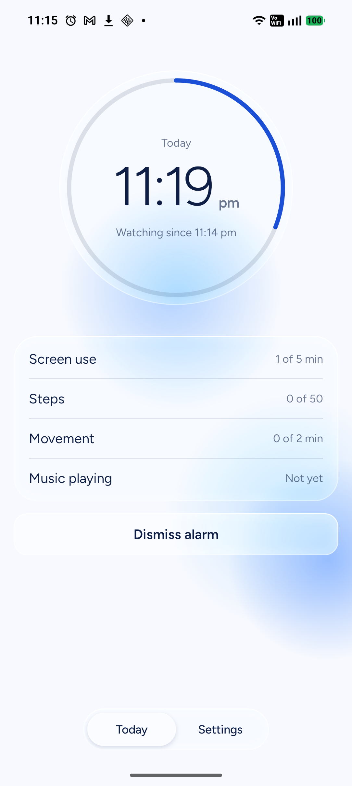
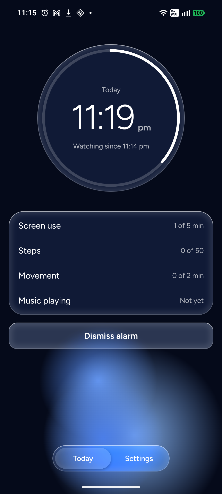
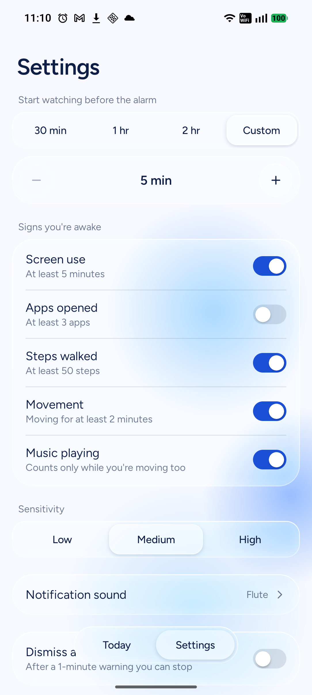
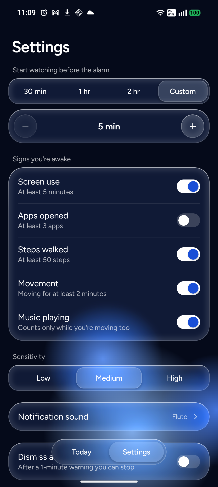
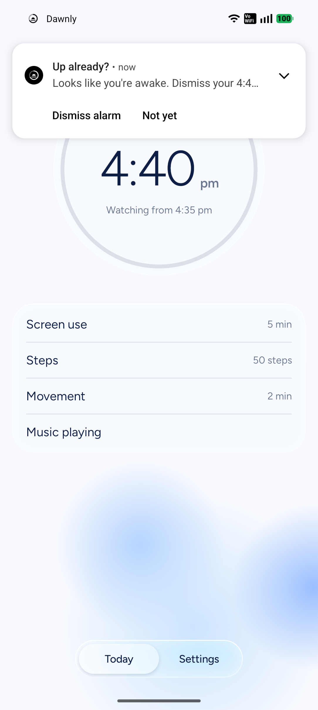
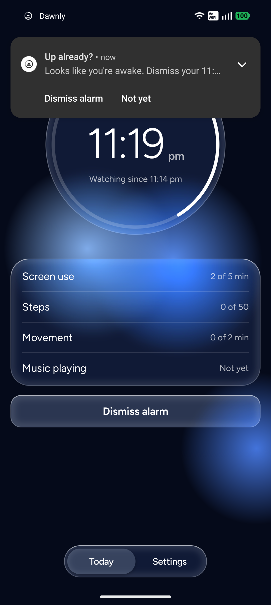

# Dawnly

[](https://github.com/AryanLanke/Dawnly/actions/workflows/ci.yml)

**An Android app that notices you're already up and offers to switch off your alarm before it rings.**

I set an alarm for 5:30, wake up at 5:00 on my own, pick up my phone and start my day, and at 5:30 the alarm goes off anyway. Dawnly fixes that. It works with the alarms you already have in your Clock app. It quietly watches for signs you're awake in a short window before the alarm, then asks: *"Up already? Looks like you're awake. Dismiss your 5:30 alarm?"* One tap, and the Clock app dismisses it.

Kotlin · Jetpack Compose · fully offline · no account · runs only before your alarm

<p align="center">
  
</p>

## Screenshots

| | Light | Dark |
|---|---|---|
| **Today**, watching before the alarm |  |  |
| **Settings** |  |  |
| **The prompt** |  |  |

## How it works

1. **Reads your next alarm.** `AlarmManager.getNextAlarmClock()` gives the next alarm set in any Clock app (Google, Samsung, Xiaomi). Dawnly follows `ACTION_NEXT_ALARM_CLOCK_CHANGED`, so it updates as soon as you change an alarm. Dawnly never sets alarms of its own.
2. **Watches only during a window you choose** (30 min, 1 hr, 2 hr, or custom) before that alarm. An exact alarm starts a quiet foreground service when the window opens; it stops when the alarm rings or is dismissed. Nothing runs all night.
3. **Looks for signs you're awake.** Each sign has a goal, set by one Low / Medium / High control:

   | Sign | Read from | Medium goal |
   |---|---|---|
   | Screen use | Unlock and screen on/off broadcasts | 5 minutes |
   | Apps opened | Usage access (`UsageStatsManager`) | 3 apps |
   | Steps | Step counter sensor | 50 steps |
   | Movement | Accelerometer | 2 minutes moving |
   | Music playing | `AudioManager` | Only adds to movement |

   Each sign's progress toward its goal adds up, and you count as awake at 100%: one sign at its goal, or a mix (3 of 5 minutes on screen plus 20 of 50 steps). A quick 3 AM time check adds only a sliver. Music never counts alone, because people fall asleep to music.
4. **Asks before it acts.** A notification asks whether to dismiss the alarm. **Dismiss alarm** sends `AlarmClock.ACTION_DISMISS_ALARM` to the Clock app. If the Clock app can't take that request, Dawnly opens it and says why. You can opt in to **Dismiss automatically**: then Dawnly shows a one-minute countdown you can stop before it dismisses. This works with the phone locked in a pocket. When the alarm is dismissed, Dawnly plays your notification sound backwards and goes back to the app you were in, so no Clock screen is left open.

### Architecture

Single module, MVVM, manual dependency wiring (small enough that a DI library would be overhead).

```
app/src/main/java/com/dawnly/app/
├─ data/      next alarm + Clock app intents, DataStore settings, saved wake progress
├─ domain/    pure Kotlin, unit tested: WatchPlanner (watch state), WakeTracker + WakeScore (wake detection)
├─ service/   WatchScheduler (the single reconcile() entry point), WatchService, WakeWatcher (sensors, broadcasts)
├─ notify/    AwakeNotifier (the prompt), DismissGuard, QuietDismiss, ReturnPlan, DismissedNotice, auto-dismiss
└─ ui/        Compose screens and the glass design system (ui/glass), theme, permissions
```

Debug-only code (the wake detection screen and an adb test receiver) lives in `app/src/debug/`, so it never ships in the release app.

- **One entry point.** Everything that can change the plan (opening the app, a settings change, the next alarm changing, a reboot, an app update, our own alarm firing) calls `WatchScheduler.reconcile()`. It works the state out from scratch every time, so it's safe to call any number of times.
- **Pure logic, tested.** `WatchPlanner.decide()` returns Idle, Waiting, Watching or Skipped. `WakeTracker` turns raw events into readings, and `WakeScore` judges them. None of them touch Android, so they're plain JUnit tests (63 in total).
- **The UI is a design system, not a theme.** `ui/glass/` has translucent glass surfaces (blur via [Haze](https://github.com/chrisbanes/haze)), a flowing background drawn in the draw phase only, spring motion, and a progress ring. Everything is Compose, with light and dark modes, and the motion stays still when the system's reduce-animations setting is on. The mockups it was built from are in [design/mockups.html](design/mockups.html), and the liquid-glass app icon and the script that draws it are in [design/app-icon](design/app-icon).

## Tech stack

| | |
|---|---|
| Language | Kotlin 2.4 |
| UI | Jetpack Compose (Material 3 base, heavily customised), Haze for blur, Figtree font |
| Architecture | MVVM, single module, `ui` / `data` / `domain` / `service` / `notify` packages |
| Storage | Jetpack DataStore (Preferences) |
| Background work | `AlarmManager` exact alarms, a foreground service, dynamically registered receivers, sensors |
| Tests | JUnit 4 unit tests for the planner, wake tracking, scoring, the dismiss guard and UI state |
| Build | Gradle 9.8 with a version catalog, AGP 9.4, R8 for release |
| CI | GitHub Actions: unit tests, debug build and lint on every push and pull request |
| Platform | minSdk 26 (Android 8.0), target and compile SDK 37 |

## Challenges I solved

**Background limits.** Android 12+ won't let an app start a foreground service from the background, except right after an exact alarm fires. A next-alarm change can arrive while Dawnly is in the background, mid-window. So when `reconcile()` can't start the service (`ForegroundServiceStartNotAllowedException`), it schedules our own exact alarm for "now" and starts the service from there. Wake signals that can't be declared in the manifest (`USER_PRESENT`, `SCREEN_ON`/`OFF`) are registered inside the running service.

**Exact alarms, and the hour-long delay without them.** On Android 14+, "Alarms & reminders" (`SCHEDULE_EXACT_ALARM`) is off by default. Without it Dawnly falls back to `setAndAllowWhileIdle`, and on my test phone (Android 16) Android gave that alarm a one-hour delivery window. That's the entire watch window, so watching could start too late to matter. Onboarding makes the case for the permission ("Android can start watching up to an hour late"), and Home shows a warning while it's off. One more trap: Dawnly must never use `setAlarmClock()` for its own alarm, because that alarm would become the "next alarm" it reads.

**OEM battery killers on Samsung and Xiaomi.** Both stop background apps far more aggressively than stock Android, even with the standard battery exemption. Onboarding asks for that exemption with a one-tap system dialog. On Samsung and Xiaomi it also opens the brand's own screen: Never sleeping apps on Samsung, Autostart and No restrictions on Xiaomi (from [dontkillmyapp.com](https://dontkillmyapp.com)), falling back to app info if a screen doesn't exist. If the process is killed mid-window anyway, `WakeProgressStore` saves the readings so the restarted service carries on, and never asks twice.

**Foreground service types.** Android 14 requires a type for every foreground service, and none of the standard ones fit "watching for signs someone woke up early". `health` comes closest, but it needs Physical activity granted before every start, and steps can be switched off. `dataSync` has a daily cap on Android 15, and `shortService` stops after 3 minutes. Dawnly uses `specialUse`, with the reason declared in the manifest for Play review. The step counter and accelerometer work under any type.

**The "Skipped" rule for alarms set mid-window.** If an alarm first appears after its watch window has started (a snooze, a short nap, or editing the time at 4:55 for 5:00), the user is clearly awake right then, and Dawnly would flag them straight away. So only alarms whose window start Dawnly scheduled ahead of time ("armed", saved in DataStore) are watched; anything else is Skipped, and Home says so. Saving the armed alarm also means watching resumes after a reboot.

**One notification channel per sound.** Android fixes a channel's sound the moment the channel is created; an app can't change it afterwards. To let the user pick the prompt's sound (17 bundled sounds), each sound gets its own channel (`awake_retro`, `awake_flute`, …). Choosing a sound creates its channel and deletes the old one, and the app re-syncs on start in case an update or a restore left them out of step.

**Never dismissing the wrong alarm.** `ACTION_DISMISS_ALARM` with "next alarm" dismisses whatever is next *when the request arrives*. A prompt about today's 5:30 tapped after that alarm was already dismissed would skip tomorrow's. `DismissGuard` (unit tested) checks the prompt's alarm is still next and still ahead, both before posting and again before dismissing. The prompt is also removed as soon as the next alarm changes.

**Auto-dismiss from the background.** Starting another app's activity from the background is blocked on Android 10+, so the opt-in auto-dismiss asks for "Display over other apps", the one standard exemption. Dawnly asks only when that switch is turned on, and never draws anything over other apps. If the countdown can't be shown, or can't finish before the alarm, Dawnly asks instead.

## Build and run

You need Android Studio (for the SDK and JDK) or the Android SDK command-line tools, and a phone with USB debugging on.

```bash
git clone https://github.com/AryanLanke/Dawnly.git
cd Dawnly
./gradlew installDebug            # Windows: .\gradlew.bat installDebug
```

Then open Dawnly on the phone and walk through the permission steps (each one can be skipped).

```bash
./gradlew testDebugUnitTest       # unit tests
./gradlew lintDebug               # lint
./gradlew assembleRelease         # minified release build (needs your own signing config)
```

Debug builds add a **Dawnly debug** launcher icon. It shows live sign readings and lets you change the goals, so you can test detection quickly. To show the prompt without waiting for detection:

```bash
adb shell am broadcast -a com.dawnly.app.debug.USER_AWAKE -p com.dawnly.app
```

## Status

Tested on a Nothing Phone (2a), Android 16, with Google Clock. Dawnly reads and dismisses alarms there, including a repeating alarm (only the next ring is skipped). Samsung Clock and Xiaomi Clock aren't tested yet; for any Clock app that can't take a dismiss request, Dawnly opens the Clock app instead.

## Credits

- [Figtree](https://github.com/erikdkennedy/figtree) by Erik Kennedy, SIL Open Font License ([licence](app/src/main/assets/licenses/figtree_OFL.txt)).
- Notification sounds from [Mixkit](https://mixkit.co/free-sound-effects/), Mixkit Sound Effects Free License ([details](app/src/main/assets/licenses/mixkit_sounds.txt)).

## Licence

Copyright © 2026 Aryan Lanke. All rights reserved: the code is here to read, not to reuse. See [LICENSE](LICENSE). The font and sounds above keep their own licences.
