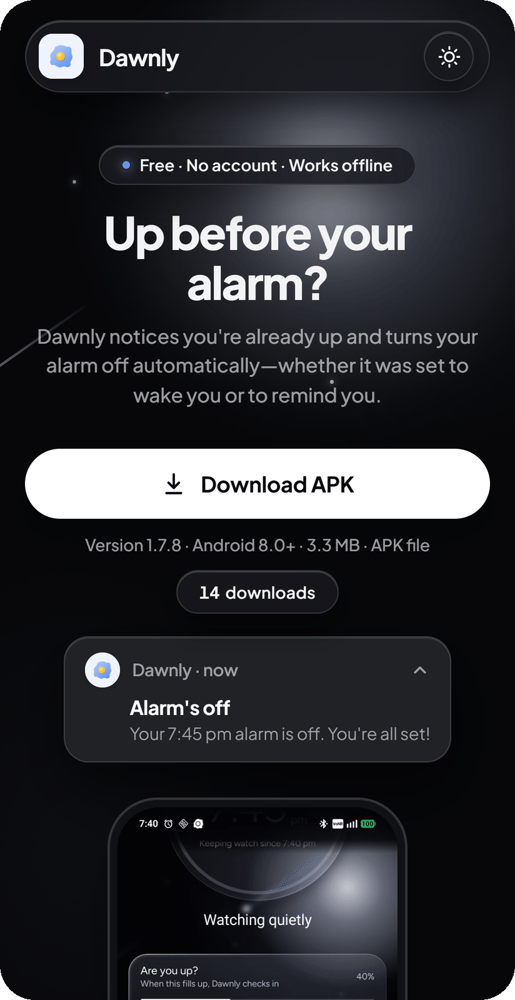

# Dawnly

**An Android app that notices you're already up and offers to switch off your alarm before it rings.**

I set an alarm for 5:30, wake up at 5:00 on my own, pick up my phone and start my day, and at 5:30 the alarm goes off anyway. Dawnly fixes that. It works with the alarms you already have in your Clock app. It quietly watches for signs you're awake in a short window before the alarm, then asks: *"Up already? Looks like you're awake. Dismiss your 5:30 alarm?"* One tap, and the Clock app dismisses it.

Kotlin · Jetpack Compose · fully offline · no account · watches only in the short window before your alarm

It also has **Reminders** ("Drink water, every 20 minutes") and **learns from your mornings**, so it asks sooner or later to suit you.

<p align="center">
  
</p>

## Try it

**[Download Dawnly from dawnlyapp.pages.dev →](https://dawnlyapp.pages.dev)**

Open the link on your Android phone (Android 8.0 or newer). On a computer the download button is hidden and the page asks you to open it on your phone. It's a signed APK, free, with no account: tap it, allow installs from your browser, and Dawnly walks you through the rest. Android warns about any app that isn't from the Play Store; that warning is normal for an APK. The site's own code is in [dawnly-firstlight](https://github.com/AryanLanke/dawnly-firstlight).

## What it does

- **Turns off an alarm you've beaten.** In a short window before your alarm, Dawnly looks for signs you're up (screen use, apps opened, steps, movement, the charger unplugged) and offers to dismiss the alarm in your Clock app. You choose: **Ask me**, **Warn first** (a one-minute countdown), or **Right away**.
- **Works with your Clock app.** It reads the next alarm from Google, Samsung or Xiaomi Clock, and can set new ones there from Today on glass time wheels. Edits and deletes stay in the Clock app.
- **Reminders.** A name, an optional "why", and a time: once a day, or every 15, 20, 30 or 60 minutes (or any custom gap) between two times. Pick which days, a sound, and whether it comes as a notification or **rings like an alarm**.
- **Learns your mornings.** "Not yet" makes it more careful, a quick "Dismiss" makes it bolder, and it learns your usual weekday and weekend wake-up times. All of it stays on the phone.
- **Glass design.** Translucent glass over a living sky (clouds by day, stars and a moon at night) in Light, Dark, System or Clock mode, holding 120 Hz while scrolling. Press and hold any choice to slide across it.
- **Private by design.** No internet permission, no account, nothing sent anywhere.

## How it works

1. **Reads your next alarm.** `AlarmManager.getNextAlarmClock()` gives the next alarm set in any Clock app (Google, Samsung, Xiaomi). Dawnly follows `ACTION_NEXT_ALARM_CLOCK_CHANGED`, so it updates as soon as you change an alarm. You can also set an alarm from Today: Dawnly picks the time on its glass wheels and hands it to the Clock app with `AlarmClock.ACTION_SET_ALARM`, so the alarm lives in the Clock app like any other. To change or delete an alarm, tapping it on Today opens the Clock app: Android gives apps no way to edit another app's alarms. Dawnly keeps only one kind of alarm itself: a set for a date other than today, which it rings as a one-day reminder, since the Clock app can't be given a date.
2. **Watches only during a window you choose** (30 min, 1 hr, 2 hr, or custom from 5 min to 3 hr 59 min) before that alarm. An exact alarm starts a quiet foreground service when the window opens; it stops when the alarm rings or is dismissed. Nothing runs all night.
3. **Looks for signs you're awake.** Each sign has a goal, set by one Low / Medium / High control:

   | Sign | Read from | Medium goal |
   |---|---|---|
   | Screen use | Unlock and screen on/off broadcasts | 5 minutes |
   | Apps opened | Usage access (`UsageStatsManager`) | 3 apps |
   | Steps | Step counter sensor | 50 steps |
   | Movement | Accelerometer | 2 minutes moving |
   | Charger unplugged | Power disconnected broadcast | Adds 40%, never enough alone |
   | Music playing | `AudioManager` | Only adds to movement |

   Each sign's progress toward its goal adds up, and you count as awake at 100%: one sign at its goal, or a mix (3 of 5 minutes on screen plus 20 of 50 steps). A quick 3 AM time check adds only a sliver. Music never counts alone, because people fall asleep to music. The activity also has to keep going for a few minutes, so a trip to the bathroom followed by going back to bed doesn't count. Activity close to the alarm counts for more: goals are 20% lower in the last 10 minutes and up to 40% higher two hours out.

   **Learning from you** (on by default, with a Start over button) nudges those goals. Every "Not yet" makes Dawnly 15% more cautious, a quick "Dismiss" (under 2 minutes) makes it 4% bolder, and it keeps your usual weekday and weekend wake-up times and which signs you trust most. It's all kept on the phone, and nothing is recorded while Learning is off.
4. **Asks before it acts.** A notification asks whether to dismiss the alarm. **Dismiss alarm** sends `AlarmClock.ACTION_DISMISS_ALARM` to the Clock app. Clock apps differ, so Dawnly tries three forms of the request in turn and remembers which one worked for yours. If none works, it says "Your alarm is still on" and tries once more before the alarm. In Settings, **When you're up** offers three choices: **Ask me** (the default), **Warn first** (a one-minute countdown you can stop, then Dawnly dismisses), or **Right away** (Dawnly dismisses with no warning). Both automatic choices work with the phone locked in a pocket. When the alarm is dismissed, Dawnly goes back to the app you were in, so no Clock screen is left open, and plays your notification sound backwards (forwards with Right away, since no earlier sound was played).

### Reminders

Today also has reminders: a name, an optional "why", and a time. A reminder comes once a day, or **every** 15, 20, 30 or 60 minutes (or any custom time from 1 minute to 23 hr 59 min) between two times, and it can run past midnight. **Which days** is every day, just today, just tomorrow, today and tomorrow, a particular date, or from one date to another. Each reminder has a sound from Dawnly's list, and comes as a notification or **rings like an alarm**: a full-screen ring that repeats its sound (each play fading out, getting louder over the first 20 seconds) until you tap Stop or Snooze 10 min, for at most 5 minutes. They use exact alarms when "Alarms & reminders" is allowed, and are set again after a reboot or an app update.

### Settings

- **Appearance:** Light, Dark, System, or **Clock** (the default: night from 7 pm to 6 am). Switching sweeps the new look in from a corner (light from the top-right, dark from the bottom-left).
- **Sound:** 17 bundled sounds plus the phone's own, with a preview.
- **More options:** which signs count, sensitivity (Low, Medium, High), Learning from you, and the permissions, with a count of those that still need allowing.
- **Feedback** opens a new [GitHub issue](https://github.com/AryanLanke/Dawnly/issues/new) in your browser with the app version and phone model filled in. Dawnly sends nothing itself.

### Architecture

Single module, MVVM, manual dependency wiring (small enough that a DI library would be overhead).

```
app/src/main/java/com/dawnly/app/
├─ data/      next alarm + Clock app intents, DataStore stores (settings, reminders, learning, saved wake progress, sound)
├─ domain/    pure Kotlin, unit tested: watch state, wake detection (WakeTracker, WakeScore, Closeness), learning, reminder times
├─ service/   WatchScheduler (the single reconcile() entry point), WatchService, WakeWatcher (sensors, broadcasts), receivers
├─ notify/    the prompt (AwakeNotifier), DismissGuard, QuietDismiss, ReturnPlan, DismissedNotice, auto-dismiss, reminders
├─ system/    usage access and the list of apps that don't count
└─ ui/        Compose screens (home, settings, onboarding), the glass design system (ui/glass), theme, permissions
```

## Tech stack

| | |
|---|---|
| Language | Kotlin 2.4 |
| UI | Jetpack Compose (Material 3 base, heavily customised), Figtree font |
| Architecture | MVVM, single module, `ui` / `data` / `domain` / `service` / `notify` packages |
| Storage | Jetpack DataStore (Preferences), a little SharedPreferences |
| Background work | `AlarmManager` exact alarms, a foreground service, dynamically registered receivers, sensors |
| Tests | 151 JUnit 4 unit tests: planner, wake tracking and scoring, learning, reminder times, the dismiss guard, return plan and UI state |
| Build | Gradle 9.8 with a version catalog, AGP 9.4, R8 for release |
| CI | GitHub Actions: unit tests, debug build and lint on every push and pull request |
| Platform | minSdk 26 (Android 8.0), target and compile SDK 37 |
| Size | About 3 MB release APK (R8 and resource shrinking) |

## Challenges I solved

**Background limits.** Android 12+ won't let an app start a foreground service from the background, except right after an exact alarm fires. A next-alarm change can arrive while Dawnly is in the background, mid-window. So when `reconcile()` can't start the service (`ForegroundServiceStartNotAllowedException`), it schedules our own exact alarm for "now" and starts the service from there. Wake signals that can't be declared in the manifest (`USER_PRESENT`, `SCREEN_ON`/`OFF`) are registered inside the running service.

**Exact alarms, and the hour-long delay without them.** On Android 14+, "Alarms & reminders" (`SCHEDULE_EXACT_ALARM`) is off by default. Without it Dawnly falls back to `setAndAllowWhileIdle`, and on my test phone (Android 16) Android gave that alarm a one-hour delivery window. That's the entire watch window, so watching could start too late to matter. Onboarding makes the case for the permission ("Android can start watching up to an hour late"), and Home shows a warning while it's off. One more trap: Dawnly must never use `setAlarmClock()` for its own alarm, because that alarm would become the "next alarm" it reads.

**OEM battery killers on Samsung, Xiaomi and OPPO.** These stop background apps far more aggressively than stock Android, even with the standard battery exemption. Onboarding asks for that exemption with a one-tap system dialog. On Samsung, Xiaomi (Redmi, POCO) and OPPO (OnePlus, realme) it also opens the brand's own screen: Never sleeping apps on Samsung, Autostart and No restrictions on Xiaomi (from [dontkillmyapp.com](https://dontkillmyapp.com)), falling back to app info if a screen doesn't exist. If the process is killed mid-window anyway, `WakeProgressStore` saves the readings so the restarted service carries on, and never asks twice.

**Foreground service types.** Android 14 requires a type for every foreground service, and none of the standard ones fit "watching for signs someone woke up early". `health` comes closest, but it needs Physical activity granted before every start, and steps can be switched off. `dataSync` has a daily cap on Android 15, and `shortService` stops after 3 minutes. Dawnly uses `specialUse`, with the reason declared in the manifest for Play review. The step counter and accelerometer work under any type.

**The "Skipped" rule for alarms set mid-window.** If an alarm first appears after its watch window has started (a snooze, a short nap, or editing the time at 4:55 for 5:00), the user is clearly awake right then, and Dawnly would flag them straight away. So only alarms whose window start Dawnly scheduled ahead of time ("armed", saved in DataStore) are watched; anything else is Skipped, and Home says so. Saving the armed alarm also means watching resumes after a reboot.

**One notification channel per sound.** Android fixes a channel's sound the moment the channel is created; an app can't change it afterwards. To let the user pick the prompt's sound (17 bundled sounds), each sound gets its own channel (`awake_retro`, `awake_flute`, …); the "Alarm's off" notice and each reminder sound have theirs too. Choosing a sound creates its channel and deletes the old one, and the app re-syncs on start in case an update or a restore left them out of step. One small helper (`SoundChannels`) does this for all of them.

**Never dismissing the wrong alarm.** `ACTION_DISMISS_ALARM` with "next alarm" dismisses whatever is next *when the request arrives*. A prompt about today's 5:30 tapped after that alarm was already dismissed would skip tomorrow's. `DismissGuard` (unit tested) checks the prompt's alarm is still next and still ahead, both before posting and again before dismissing. The prompt is also removed as soon as the next alarm changes.

**Auto-dismiss from the background.** Starting another app's activity from the background is blocked on Android 10+, so the automatic choices work through a full-screen notification, which opens by itself on a locked phone. "Display over other apps" is optional: when it's allowed, Dawnly can skip a tap with the phone in use. Dawnly never draws anything over other apps. If the countdown can't be shown, or can't finish before the alarm, Dawnly asks instead. On Android 13+, an app installed from a file also meets the "Restricted setting" lock for Usage access and the overlay, so Dawnly shows step-by-step help for unlocking it.

## Status

Tested on a Nothing Phone (2a), Android 16, with Google Clock. Dawnly reads and dismisses alarms there, including a repeating alarm (only the next ring is skipped). Testers have also run it on Motorola, Redmi, OPPO and OnePlus phones. Samsung Clock and Xiaomi Clock aren't tested yet; for any Clock app that can't take a dismiss request, Dawnly opens the Clock app instead.

## Credits

- [Figtree](https://github.com/erikdkennedy/figtree) by Erik Kennedy, SIL Open Font License ([licence](app/src/main/assets/licenses/figtree_OFL.txt)).
- Notification sounds from [Mixkit](https://mixkit.co/free-sound-effects/), Mixkit Sound Effects Free License ([details](app/src/main/assets/licenses/mixkit_sounds.txt)).

## Changelog and privacy

What changed in each version is in [CHANGELOG.md](CHANGELOG.md). The privacy policy is [docs/privacy-policy.md](docs/privacy-policy.md).

## Licence

The code is MIT licensed: copyright © 2026 Aryan Lanke, see [LICENSE](LICENSE). The egg icon stays all rights reserved, and the font and sounds above keep their own licences.
